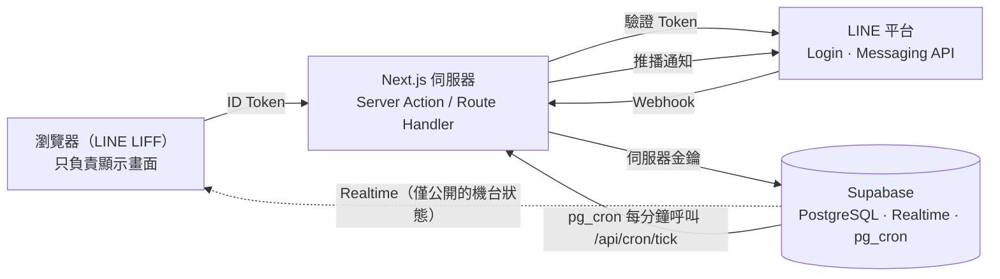
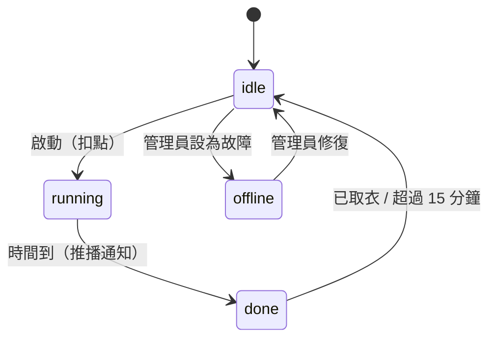

# LINE 自助洗衣系統

在 LINE 裡掃洗衣機上的 QR Code 就能啟動機台、即時查看剩餘時間，洗好時收到 LINE 推播通知。

**正式網址**：https://line-liff-laundry.vercel.app

> 🚧 **開發中**：目前已完成專案建置與自動部署，各項功能依下方「開發進度」逐步完成。


## 功能

**使用者**
- 用 LINE 掃機台 QR Code，直接打開該機台的頁面，免註冊、免另外登入
- 選擇洗程方案、以點數付款並啟動機台
- 即時查看所有機台狀態與剩餘時間，不用重新整理
- 洗好時收到 LINE 推播，逾時未取衣再提醒一次
- 查看個人使用紀錄與點數餘額

**管理員**
- 查看所有機台狀態、將機台設為故障或恢復
- 查看今日營收、為使用者儲值點數

## 使用流程

1. 用 LINE 掃描洗衣機上的 QR Code，開啟該機台頁面
2. 選擇方案（例如標準洗 40 點、快洗 30 點），按下「開始」
3. 伺服器驗證身分、扣點並啟動機台，畫面進入倒數
4. 其他人的機台列表同步顯示「運轉中」
5. 時間到時收到 LINE 推播「3 號洗衣機洗好了」
6. 5 分鐘內未取衣會再推播一次；按下「已取衣」後機台回到閒置

## 系統架構



設計原則：

1. **瀏覽器不能寫入資料庫**：所有寫入都經過 Next.js 伺服器，伺服器先向 LINE 驗證 ID Token，取得可信的使用者身分後才寫入。
2. **瀏覽器只能讀公開資料**：機台狀態與方案價格是公開資訊，開放即時訂閱；使用紀錄與餘額屬於個人資料，只能透過伺服器讀取。
3. **「檢查＋寫入」在資料庫函式內完成**：以交易與資料列鎖保證多個請求同時進來時，結果仍然正確。

### 機台狀態



## 技術重點

| 面向 | 做法 |
| --- | --- |
| 身分驗證 | 不信任前端傳來的 userId，伺服器以 LINE 驗證 API 檢查 LIFF ID Token |
| 資料庫安全 | 所有資料表啟用 Row Level Security，只有機台與方案開放公開讀取；伺服器金鑰僅存在於 `server-only` 模組 |
| 併發控制 | 兩人同時搶同一台機台、同一人餘額只夠一次卻同時送出兩次，皆以 `select ... for update` 加上固定的上鎖順序處理 |
| 交易一致性 | 扣點、建立使用紀錄、更新機台狀態在同一個交易內完成，全部成功或全部失敗；點數異動都留有流水帳 |
| 即時更新 | Supabase Realtime 推送機台狀態變化，前端依結束時間倒數 |
| 排程與通知 | pg_cron 每分鐘觸發檢查，透過 LINE Messaging API 推播；排程用的網址與密鑰存放於 Supabase Vault |
| Webhook 安全 | 以原始 request body 驗證 `x-line-signature`，使用 timing-safe 比對 |
| 測試與 CI | Vitest 單元與整合測試（含併發情境）、Playwright 端對端測試，GitHub Actions 於每次 push 自動執行 |

## 技術棧

- **前端**：Next.js 16（App Router）、React 19、TypeScript、Tailwind CSS 4
- **後端**：Next.js Server Actions、Route Handlers
- **資料庫**：Supabase（PostgreSQL、Row Level Security、Realtime、pg_cron、Vault）
- **LINE**：LIFF、LINE Login、Messaging API
- **測試**：Vitest、Playwright
- **部署**：Vercel（push 到 `main` 自動部署）

## 資料表

| 資料表 | 用途 |
| --- | --- |
| `users` | LINE 使用者與點數餘額（資料庫層保證餘額不為負數） |
| `machines` | 機台代碼、名稱、類型（洗衣／烘衣）與狀態 |
| `programs` | 洗程方案：時間與價格 |
| `sessions` | 每次使用紀錄，記錄當下價格；同一台機台同時只能有一筆運轉中 |
| `wallet_transactions` | 點數異動流水帳 |

## 開發進度

- [x] 建立 Next.js 專案、推上 GitHub、部署到 Vercel
- [ ] 首頁機台列表與機台頁面
- [ ] Supabase 資料表、RLS 與公開讀取
- [ ] LIFF 登入與 ID Token 伺服器驗證
- [ ] 啟動機台：扣點、交易與併發控制
- [ ] 掃碼啟動、使用紀錄頁
- [ ] 即時狀態與倒數計時
- [ ] 排程檢查與 LINE 推播通知
- [ ] Webhook 簽章驗證、加好友歡迎訊息、Rich Menu
- [ ] 管理後台
- [ ] 單元、整合、端對端測試與 CI

## 本機開發

```bash
git clone https://github.com/michael9487/line-liff-laundry.git
cd line-liff-laundry
npm install
npm run dev
```

開啟 http://localhost:3000 。

### 環境變數

在專案根目錄建立 `.env.local`（已被 `.gitignore` 排除）。只有 `NEXT_PUBLIC_` 開頭的變數會進入瀏覽器端程式碼。

| 名稱 | 範圍 | 用途 |
| --- | --- | --- |
| `NEXT_PUBLIC_LIFF_ID` | 公開 | 初始化 LIFF |
| `NEXT_PUBLIC_SUPABASE_URL` | 公開 | Supabase 專案網址 |
| `NEXT_PUBLIC_SUPABASE_PUBLISHABLE_KEY` | 公開 | 瀏覽器訂閱 Realtime |
| `SUPABASE_SECRET_KEY` | 伺服器 | 伺服器存取資料庫 |
| `LINE_LOGIN_CHANNEL_ID` | 伺服器 | 驗證 ID Token |
| `LINE_MESSAGING_CHANNEL_SECRET` | 伺服器 | 驗證 Webhook 簽章 |
| `LINE_MESSAGING_ACCESS_TOKEN` | 伺服器 | 發送推播 |
| `CRON_SECRET` | 伺服器 | 排程呼叫的驗證密鑰 |
| `ADMIN_LINE_USER_IDS` | 伺服器 | 管理員的 LINE userId（逗號分隔） |
